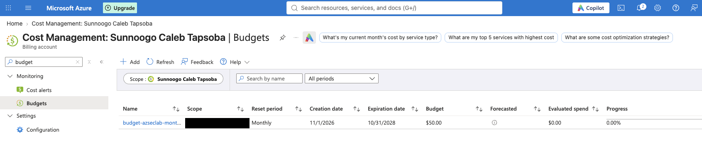

# Bloc 1 — Compte et garde-fous

**Statut** : terminé — 07/11/2026
**Durée** : environ 2 heures, réparties sur deux sessions
**Coût engagé** : 0 €

---

## 1. À quoi sert ce bloc

Rien n'est encore déployé. C'est précisément le moment de poser les garde-fous, parce qu'un garde-fou posé après l'accident ne sert plus à rien.

Trois questions, auxquelles toute plateforme doit pouvoir répondre **avant** d'accueillir la première ressource :

1. **Et si ça coûte trop cher ?** — on veut être prévenu avant la facture, pas après.
2. **Qui a le droit de faire quoi, et où ?** — et comment on le retire le jour où quelqu'un part.
3. **Comment s'y retrouve-t-on dans six mois ?** — une ressource dont le nom n'explique rien est une ressource que personne n'ose supprimer.

C'est le bloc le moins spectaculaire du projet. C'est aussi celui dont l'absence se paie le plus cher.

---

## 2. Budget et alertes

### Le raisonnement

L'intuition commune range le budget du côté de la comptabilité. C'est une erreur de lecture.

Reprenons le [scénario 2](../01-scenarios-attaque.md) : un attaquant récupère une identité de pipeline et déploie des machines de calcul pour miner de la cryptomonnaie. Il ne chiffre rien, ne vole rien de visible, et choisit des régions que l'entreprise n'utilise pas. Aucune alerte de sécurité ne se déclenche, parce que du point de vue d'Azure, rien d'anormal ne se produit : une identité autorisée crée des ressources qu'elle a le droit de créer.

**Le seul signal, pendant cinq semaines, est la courbe de dépense.**

D'où la formulation à retenir : *l'alerte budgétaire fait partie du dispositif de détection.* Cette technique est répertoriée au MITRE ATT&CK sous l'identifiant **T1496 — Resource Hijacking**.

### Le choix réel vs prévisionnel

Azure propose deux types de seuils, et ils n'ont pas la même valeur :

| Type | Se déclenche quand | Utilité |
|---|---|---|
| **Actual** | l'argent est déjà dépensé | constat |
| **Forecasted** | Azure *projette* un dépassement | **anticipation — parfois plusieurs jours d'avance** |

Configuration retenue : `Actual 50 %`, `Actual 80 %`, **`Forecasted 100 %`**. Le troisième est celui qui a une valeur défensive.

### Mise en œuvre

Budget mensuel de 50 €, créé dans le portail au niveau du compte de facturation.



**Pourquoi le portail et pas la CLI** : la commande `az consumption budget` au niveau abonnement a été retirée des versions récentes de l'Azure CLI. Un budget reste par ailleurs un garde-fou de *compte*, créé une fois — il ne relève pas du cycle de vie de l'infrastructure.

**Limite assumée, à corriger au Bloc 2** : ce budget est rattaché au *compte de facturation*, pas à l'abonnement. Il fonctionne, mais n'est pas reproductible en Terraform. Un second budget sera déclaré au Bloc 2 via `azurerm_consumption_budget_subscription`.

---

## 3. Identités et RBAC

### Pourquoi des groupes et jamais des personnes

Un rôle attribué à un individu devient invisible : il survit à son changement d'équipe, à son départ, et n'apparaît dans aucun processus de sortie. Six mois plus tard, personne ne sait plus pourquoi cette personne est Contributor sur cette ressource — et personne n'ose le retirer.

Un rôle attribué à un **groupe** se révoque en retirant la personne du groupe : une seule action, au même endroit que toutes les autres, tracée.

> **Formulation d'entretien.** « On n'attribue jamais un rôle à un utilisateur. On l'attribue à un groupe, et on gère l'appartenance au groupe. »

### Les trois groupes

Ils représentent trois métiers réels chez l'entreprise simulée :

| Groupe | Qui, dans la vraie vie | Peut | Ne peut pas |
|---|---|---|---|
| `grp-asl-platform-admins` | ingénieur cloud, lead infra | créer et détruire l'infrastructure | — |
| `grp-asl-dev-contributors` | les développeurs du portail | déployer en **dev** | toucher à la production |
| `grp-asl-security-readers` | analyste sécurité, auditeur | **tout voir** : configurations, journaux, alertes | **rien modifier** |

Le troisième mérite qu'on s'y arrête. L'analyste sécurité doit pouvoir enquêter sur n'importe quelle ressource ; s'il peut aussi les modifier, il peut effacer ses propres traces. **On sépare celui qui observe de celui qui agit** — c'est le même principe que la séparation entre celui qui paie et celui qui contrôle en comptabilité.

```bash
az ad group create --display-name "grp-asl-platform-admins"  --mail-nickname "grp-asl-platform-admins"
az ad group create --display-name "grp-asl-dev-contributors" --mail-nickname "grp-asl-dev-contributors"
az ad group create --display-name "grp-asl-security-readers" --mail-nickname "grp-asl-security-readers"
```

```console
$ az ad group list --query "[?starts_with(displayName, 'grp-asl')].displayName" -o table
Result
------------------------
grp-asl-security-readers
grp-asl-dev-contributors
grp-asl-platform-admins
```

**Les groupes sont volontairement vides à ce stade.** On construit la structure ; les occupants arrivent au Bloc 4 (l'identité du pipeline y entrera pour obtenir ses droits de déploiement) et au Bloc 6, dont l'incident est précisément une **escalade de privilèges** : quelqu'un s'ajoute lui-même à un groupe trop puissant, hors pipeline.

### Le modèle RBAC en trois termes

Toute attribution de rôle Azure est un triplet. Il n'y a rien d'autre à retenir :

| | Option CLI | Valeur retenue |
|---|---|---|
| **QUI** — le principal | `--assignee-object-id` | le groupe `grp-asl-security-readers` |
| **QUOI** — le rôle | `--role` | `Reader` : lire, jamais écrire |
| **OÙ** — la portée | `--scope` | l'abonnement entier |

C'est la **portée** qui porte le moindre privilège. Le rôle dit ce qu'on peut faire ; la portée dit jusqu'où. `Reader` sur l'abonnement est large et assumé — un analyste sécurité qui ne verrait qu'une partie du système ne pourrait pas faire son travail. Les deux autres groupes seront portés au niveau du *resource group*, au Bloc 2, déclarés en Terraform.

```bash
SUB=$(az account show --query id -o tsv)
GRP=$(az ad group show --group "grp-asl-security-readers" --query id -o tsv)

az role assignment create \
  --assignee-object-id "$GRP" \
  --assignee-principal-type Group \
  --role "Reader" \
  --scope "/subscriptions/$SUB"
```

```console
{
  "principalId":      "799d4b52-8810-4005-86c4-8616f86eb1a7",
  "principalType":    "Group",
  "roleDefinitionId": ".../roleDefinitions/acdd72a7-3385-48ef-bd42-f606fba81ae7",
  "scope":            "/subscriptions/<subscription-id>",
  "createdOn":        "2026-11-07T21:38:07Z"
}
```

Deux détails de méthode, qui valent au-delà de cette commande :

- **`$(az ... -o tsv)` plutôt qu'un identifiant collé en dur.** Un script qui contient un GUID d'abonnement n'est transportable nulle part, et ce GUID finit un jour dans un dépôt public.
- **`--assignee-object-id` plutôt que `--assignee`.** `--assignee` doit d'abord résoudre un nom en identifiant, ce qui échoue fréquemment sur les groupes et les principaux de service. Passer l'identifiant directement supprime l'ambiguïté.

---

## 4. Convention de nommage

Détaillée dans [`docs/02-conventions-nommage.md`](../02-conventions-nommage.md) : schéma `<type>-asl-<env>-<rôle>`, quatre étiquettes obligatoires, et les deux exceptions imposées par Azure (comptes de stockage, noms globalement uniques).

Point opérationnel immédiat : l'abonnement héberge aussi les travaux pratiques d'un cours AZ-104. L'étiquette `project=azure-security-lab` est ce qui permet de lister — et surtout de **détruire** — uniquement ce qui appartient au lab :

```bash
az resource list --tag project=azure-security-lab -o table
```

---

## 5. Inventaire de départ

Vérification faite avant tout déploiement, pour ne pas interférer avec les travaux existants sur l'abonnement :

```console
$ az group list -o table
Name            Location       Status
--------------  -------------  ---------
rg-my-firstOne  francecentral  Succeeded
```

Deux comptes de stockage vides, issus du cours AZ-104. Aucun chevauchement de nom avec les `rg-asl-*`. Coût engagé : 0 €.

---

## 6. Limites, et ce qu'on ferait ailleurs

| Point | Ce lab | PME | Entreprise |
|---|---|---|---|
| Séparation des environnements | resource groups + RBAC, un seul abonnement | un abonnement par environnement | management groups, CAF Landing Zone, une souscription par environnement et par entité |
| Élévation de privilèges | permanente | **PIM** : élévation à la demande, limitée dans le temps, justifiée et approuvée | PIM + accès conditionnel + postes d'administration dédiés |
| Budget | 1 budget, alertes par e-mail | alertes vers l'équipe et la direction financière | FinOps : refacturation par étiquettes, quotas, blocage automatique |
| Appartenance aux groupes | manuelle | gouvernance des accès, revues périodiques | provisionnement automatique depuis le SIRH, recertification trimestrielle |

**PIM** (*Privileged Identity Management*) est la limite la plus nette de ce lab : les droits accordés ici sont permanents. En entreprise, un administrateur ne *possède* pas ses droits — il les **demande** pour une durée bornée, avec justification et validation. C'est le principe du **JIT** (*Just-In-Time*). PIM requiert une licence Entra ID P2, non disponible sur ce compte ; il est documenté, pas déployé.

---

## 7. Ce que je dois savoir défendre seul

1. **Pourquoi une alerte budgétaire est un contrôle de sécurité** — et pas seulement de gestion. Référence : MITRE ATT&CK T1496.
2. **Le triplet QUI / QUOI / OÙ**, et pourquoi la *portée* est l'endroit où vit le moindre privilège.
3. **Pourquoi on n'attribue jamais un rôle à une personne**, et ce qui se passe le jour où cette personne quitte l'entreprise.
4. **Pourquoi l'analyste sécurité est Reader et pas Contributor** — qui observe n'est pas qui agit.
5. **Ce que PIM apporterait**, pourquoi il n'est pas ici, et ce que son absence coûte.
